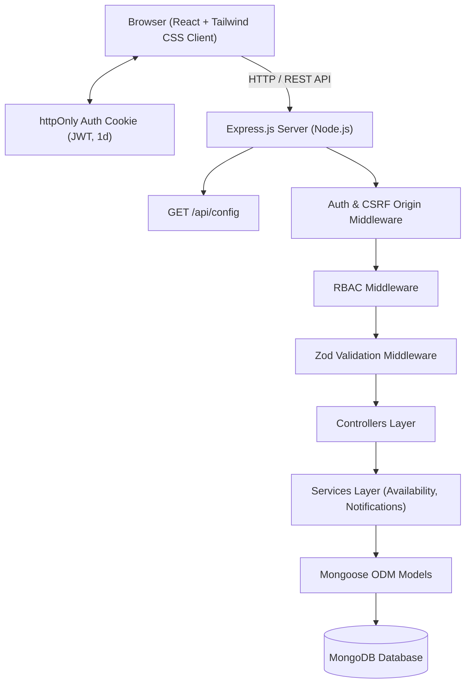
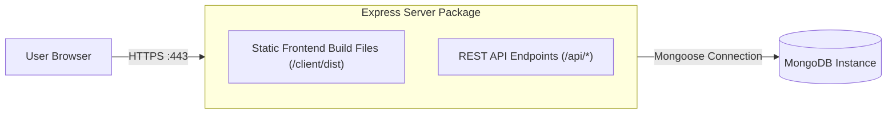

# System Architecture

## 1. High-Level Architecture Diagram

## 2. Production Deployment Architecture (Single Deployable Model D10)

## 3. Backend Layers
### Routes
Define HTTP endpoints and attach middleware.

### Middleware
Authentication (cookie JWT), CSRF Origin verification (D16), RBAC authorization, Zod schema validation, rate limiting, global error handling.

### Controllers
Translate HTTP requests into application operations. Controllers remain thin and delegate domain rules to services.

### Services
Core domain logic including slot availability calculation (D1), state machine transition validation (D2, D3, D4), and event notification generation (D5).

### Models
Mongoose schemas and database index enforcement (D6, D7, D8, D9, D19).

## 4. Frontend Layers
- Pages/routes (with 404, Privacy, Terms, and Change-Password pages - D8, D9)
- Feature components & Modals (BookingModal, MedicalRecordModal)
- Shared UI components (Navbar, StatusBadge, Footer)
- API service layer with cookie credentials
- Authentication context (`AuthContext`)
- Notification context (`NotificationContext`)
- Zod & Form validation
- Explicit Loading, Empty, and Error UI states for every page (D8)

## 5. Architectural Rules
- No database queries directly inside React components.
- No business-critical authorization only in frontend.
- No secrets in frontend source.
- Appointment conflict checks and state machine transitions belong strictly on the server.
- Express serves static production build files from `client/dist` in production (D10).
- Clinic parameters are dynamically loaded from `GET /api/config` (D18).
