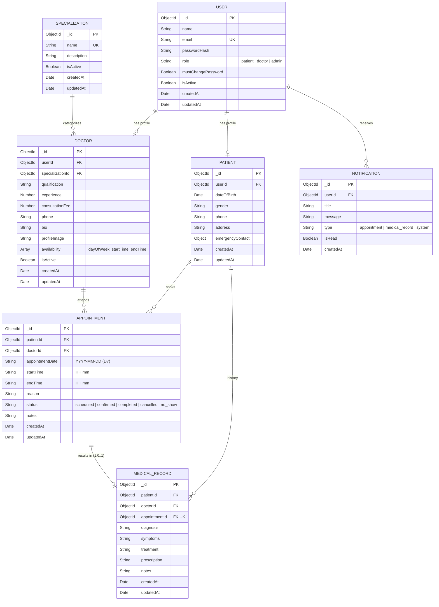

# MongoDB Database Design

## 1. Mermaid Entity-Relationship (ER) Diagram



## 2. Collections & Schema Definitions

### Collection: `users`
```js
{
  _id: ObjectId,
  name: String,            // required, trimmed
  email: String,           // required, unique, lowercase, trimmed
  passwordHash: String,    // required, select: false (Argon2 hash D16)
  role: String,            // enum: ["patient", "doctor", "admin"], required
  mustChangePassword: Boolean, // default: false (true for admin-created doctors D17)
  isActive: Boolean,       // default: true
  createdAt: Date,
  updatedAt: Date
}
```

### Collection: `doctors`
```js
{
  _id: ObjectId,
  userId: ObjectId,        // ref: 'User', required, unique
  specializationId: ObjectId, // ref: 'Specialization', required
  qualification: String,   // required
  experience: Number,      // required, min: 0
  consultationFee: Number, // required, min: 0
  phone: String,           // required
  bio: String,
  profileImage: String,
  availability: [
    {
      dayOfWeek: Number,   // 0 (Sun) to 6 (Sat)
      startTime: String,   // "HH:mm" in CLINIC_TIMEZONE (D7)
      endTime: String      // "HH:mm" in CLINIC_TIMEZONE (D7)
    }
  ],
  isActive: Boolean,       // default: true
  createdAt: Date,
  updatedAt: Date
}
```

### Collection: `patients`
```js
{
  _id: ObjectId,
  userId: ObjectId,        // ref: 'User', required, unique
  dateOfBirth: Date,
  gender: String,          // enum: ["Male", "Female", "Other", "Prefer not to say"]
  phone: String,
  address: String,         // restricted from doctors in clinical profile view (D15)
  emergencyContact: {
    name: String,
    phone: String,
    relationship: String
  },
  createdAt: Date,
  updatedAt: Date
}
```

### Collection: `specializations`
```js
{
  _id: ObjectId,
  name: String,            // required, unique, trimmed
  description: String,
  isActive: Boolean,       // default: true
  createdAt: Date,
  updatedAt: Date
}
```

### Collection: `appointments`
```js
{
  _id: ObjectId,
  patientId: ObjectId,     // ref: 'Patient', required
  doctorId: ObjectId,      // ref: 'Doctor', required
  appointmentDate: String, // format "YYYY-MM-DD" in CLINIC_TIMEZONE (D7)
  startTime: String,       // format "HH:mm" in CLINIC_TIMEZONE (D7)
  endTime: String,         // format "HH:mm" in CLINIC_TIMEZONE (D7)
  reason: String,          // required
  status: String,          // enum: ["scheduled", "confirmed", "completed", "cancelled", "no_show"]
  notes: String,
  createdAt: Date,
  updatedAt: Date
}
```

### Collection: `medicalRecords`
```js
{
  _id: ObjectId,
  patientId: ObjectId,     // ref: 'Patient', required
  doctorId: ObjectId,      // ref: 'Doctor', required (author)
  appointmentId: ObjectId, // ref: 'Appointment', required, unique (D19)
  diagnosis: String,       // required
  symptoms: String,
  treatment: String,
  prescription: String,
  notes: String,
  createdAt: Date,
  updatedAt: Date
}
```

### Collection: `notifications`
```js
{
  _id: ObjectId,
  userId: ObjectId,        // ref: 'User', required
  title: String,           // required
  message: String,         // required
  type: String,            // enum: ["appointment", "medical_record", "system"]
  isRead: Boolean,         // default: false
  createdAt: Date
}
```

## 3. Relationships Summary
- `User` 1—1 `Doctor`
- `User` 1—1 `Patient`
- `Specialization` 1—N `Doctor`
- `Doctor` 1—N `Appointment`
- `Patient` 1—N `Appointment`
- `Appointment` 1—0..1 `MedicalRecord` (strictly one record per appointment D19)
- `Patient` 1—N `MedicalRecord`
- `User` 1—N `Notification`

## 4. Index Requirements & Uniqueness Strategies

1. **Unique Active Appointment Slot Index**:
   - Compound index: `{ doctorId: 1, appointmentDate: 1, startTime: 1 }`
   - Partial Filter Expression: `{ status: { $in: ["scheduled", "confirmed"] } }`
   - **Enforcement**: Prevents double-booking two active appointments for the same doctor at the same date & time.

2. **Unique Medical Record per Appointment Index**:
   - Unique index: `{ appointmentId: 1 }` with `unique: true`
   - **Enforcement**: Guarantees exactly one medical record per appointment (D19).

3. **Lookup Performance Indexes**:
   - `users.email` (unique index)
   - `users.role`
   - `doctors.specializationId`
   - `appointments.patientId + appointmentDate`
   - `appointments.doctorId + appointmentDate`
   - `medicalRecords.patientId`
   - `medicalRecords.doctorId`
   - `notifications.userId + isRead`
