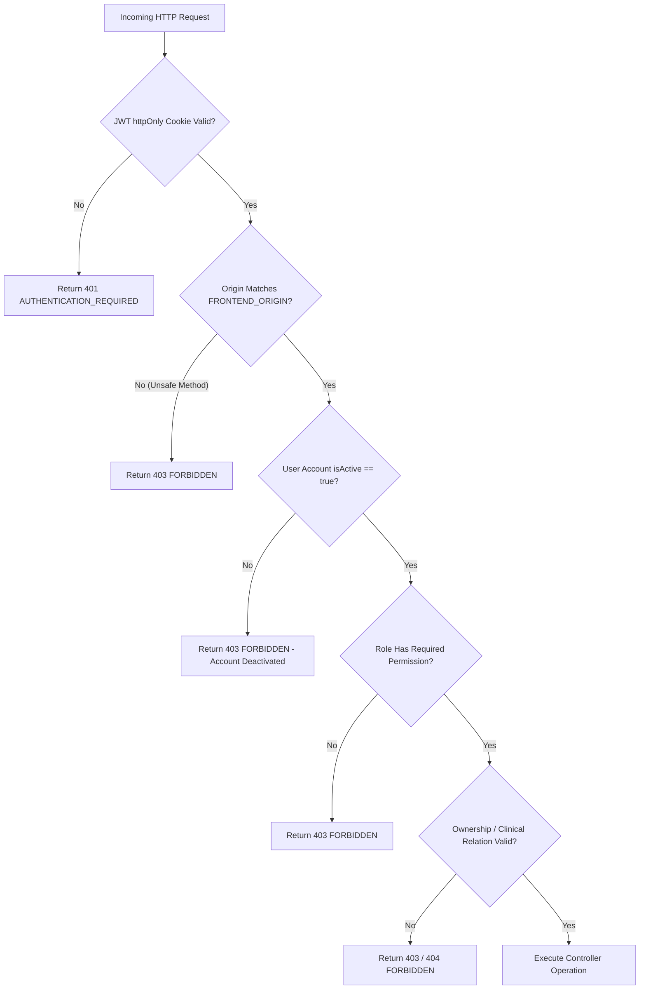

# Authentication and Authorization Specification

## 1. Authentication Strategy (D16)

- **Password Hashing**: Passwords MUST be hashed with **Argon2** (`argon2.hash`).
- **Password Policy**: Password length must be between **10 and 128 characters**.
- **Token Transport**: JWT is stored exclusively in an `httpOnly`, `SameSite=Strict` cookie (`Secure` flag enabled in production).
- **Session Lifetime**: JWT expiry is set to **1 day** (24 hours). No refresh tokens exist in v1.
- **Logout Strategy**: `POST /auth/logout` clears the `httpOnly` cookie immediately. Limitation: JWT tokens are stateless, so logout is achieved client-side via cookie clearance; server token revoking blacklist is out of scope for v1.
- **CSRF / Origin Protection**: All unsafe HTTP methods (`POST`, `PUT`, `PATCH`, `DELETE`) must verify that the request `Origin` header matches `FRONTEND_ORIGIN`.
- **Rate Limiting**: Authentication endpoints (`POST /auth/login`, `POST /auth/register`, `POST /auth/change-password`) are strictly rate-limited to **5 attempts per 15 minutes per IP**.

## 2. Onboarding & Password Change Flow (D9, D17)

- **Doctor Onboarding (D17)**: Doctors created by an admin (`POST /doctors`) receive a temporary password generated by the admin, and `mustChangePassword=true`. Upon initial login, the doctor is forced to change their password via `/change-password`.
- **Password Change Flow (D9)**: Authenticated users change their password via `POST /auth/change-password` by providing `currentPassword` and `newPassword`. Forgot-password / reset-token email delivery is out of scope for v1 (D9).

## 3. Server-Side Authorization Pipeline

Every protected API request executes the following mandatory pipeline:

## 4. Resource Access & Disclosure Policy
- Admin access to clinical medical records is strictly **DENIED** (D6).
- Patients requesting another patient's records or appointments receive `403 FORBIDDEN` or `404 NOT_FOUND` without revealing resource existence.
- Password hashes are marked `select: false` in Mongoose and are NEVER returned in API responses.
